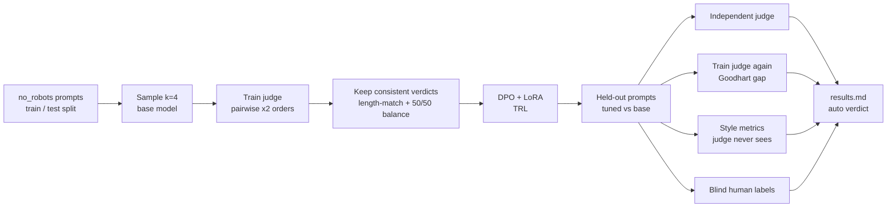

# unslop

[](https://colab.research.google.com/github/Akashkar00/unslop-rlhf/blob/main/notebooks/colab_pipeline.ipynb)

**Preference-tune a small open model so it writes like a person, then check whether it actually got better or just learned to game the judge.**

## Why this project

Y Combinator's Winter 2027 Request for Startups includes *LLMs That Write Well* (Jared Friedman):

> "As LLMs have gotten better at coding and math, they've actually gotten worse at writing… The same reward signals that make models good at code actively flatten voice and style."

That is a post-training problem. The fix is a different reward signal: preferences about prose, not pass/fail tests. Getting that signal is the easy part. The hard part is knowing whether the result is better writing or just whatever pleases the judge. YC's S26 batch includes Tokenless, a lab whose whole pitch is ending reward hacking in RL environments and evals. This repo treats both problems as one job:

1. **Preference data.** Sample candidates from `Qwen2.5-1.5B-Instruct` on human-written writing prompts ([no_robots](https://huggingface.co/datasets/HuggingFaceH4/no_robots)). Then label pairs with an LLM judge (RLAIF), position-swapped, keeping only verdicts that survive the swap.
2. **DPO + LoRA** with TRL on a free Colab T4.
3. **Audit.** An *independent* judge from a different model family, a length-controlled win rate, judge-independent style metrics, and blind human labels to measure how well the judges agree with a person.

The report's verdict is generated from the numbers. If the improvement disappears under length control, the report says "length hacking" rather than "it worked."

## Pipeline



## Reward-hacking guards, and why each one exists

| Failure mode | Guard |
|---|---|
| **Length bias.** Judges like longer answers, so DPO learns to pad. | Candidates are paired only within a 1.5x length ratio, and after judging, pairs are rebalanced so "chosen is longer" is exactly 50%. The headline metric is the **length-controlled win rate**: logistic fit of win ~ log length ratio, read at equal length. This is a simplified AlpacaEval-2 LC. |
| **Position bias.** Judges favour response A. | Every comparison runs in both orders. Training keeps only pairs where both orders agree. In eval, a flip scores 0.5. The position-consistency rate is reported. |
| **Goodhart on the judge.** Scoring with the judge you trained against measures fit to that judge. | Train judge `llama-3.3-70b` and eval judge `gpt-oss-120b` are different families. The train judge is re-run on the eval set only to report the gap between the two. |
| **Gaming a word list.** | The stock-phrase lexicon (`metrics.py`) is *not* in the judge rubric, so it stays an independent check rather than a target. |
| **Rambling.** | Truncated generations are excluded from training pairs, and the report flags it if the tuned model hits the token limit more often than the base. |
| **Judge ≠ human.** | Blind Streamlit labeler. Agreement and Cohen's κ are computed on a random sample of *all* judged pairs, not only the easy consistent ones, plus human tuned-vs-base win rate on held-out prompts. |
| **Leakage.** | Train prompts come from the no_robots train split and eval prompts from its test split, with normalized-duplicate removal across the two. |

## Quickstart

Local (analysis, labeling, tests). Requires [uv](https://docs.astral.sh/uv/):

```bash
uv sync --extra ui
cp .env.example .env        # add GROQ_API_KEY
uv run pytest
```

### Option A: Kaggle from the terminal

GPU steps run as private Kaggle kernels. Judge calls stay on your machine, so your API key never goes to Kaggle. You need the [Kaggle CLI](https://github.com/Kaggle/kaggle-cli) logged in, and your code committed and pushed, because each kernel clones the exact commit you're on.

```bash
uv run unslop kaggle-generate --smoke   # [Kaggle T4] prompts + candidates, downloaded into data/
uv run unslop build-pairs               # local: train judge → DPO pairs
uv run unslop kaggle-train --smoke      # [Kaggle T4] upload pairs (private dataset), DPO, tuned-vs-base samples
uv run unslop judge-eval                # local: independent judge + Goodhart-gap judge
uv run unslop report
```

Drop `--smoke` for the real run (1.5B model, all prompts). Add `--no-wait` to return right away, then run `unslop kaggle-fetch generate|train` later.

### Option B: Colab

Open `notebooks/colab_pipeline.ipynb`, set the runtime to T4 GPU, add `GROQ_API_KEY` under Colab *Secrets*, and run all cells. It runs:

```bash
unslop prompts                 # 400 train / ≤150 eval prompts
unslop generate                # [GPU] 4 samples per train prompt
unslop build-pairs             # train judge → DPO pairs + human queue
unslop train                   # [GPU] DPO + LoRA
unslop generate-eval           # [GPU] tuned vs base on held-out prompts
unslop judge-eval              # independent judge (+ train judge for the gap)
unslop report                  # reports/results.md
```

Then copy `data/` back from Drive and label on your Mac:

```bash
uv run streamlit run app/label_ui.py
uv run unslop report
```

Smoke-test the whole loop cheaply first by setting `SMOKE = True` in the notebook. That uses `Qwen2.5-0.5B-Instruct` and `--limit 16` on `generate`, `build-pairs` and `generate-eval`. Then check `pair_stats.json` for judge failures and `pairs_after_length_balance` before paying for the full run.

### Cost and limits

At the defaults (400 train prompts × 2 pairs × 2 orders, plus 150 eval prompts × 2 orders × 2 judges), expect about 2,200 judge calls and roughly 2.5M tokens. That's a few dollars on Groq's paid tier. The free tier's daily token caps will stop you partway. Every verdict is cached in `data/cache/judge_cache.jsonl`, so rerunning the same command resumes where it stopped. `--max-rpm` throttles requests.

Any [LiteLLM](https://docs.litellm.ai/docs/providers) model string works for either judge, for example `UNSLOP_EVAL_JUDGE=anthropic/claude-sonnet-5-5`. Keep the two judges in different model families.

## Results

Nothing here yet. Run the pipeline, and `reports/results.md` will be generated with CIs and the automatic verdict. Numbers in this README should be copied from that file, not written by hand.

## Honest limitations

- **This is RLAIF with human validation, not pure RLHF.** Training labels come from an LLM judge, so part of what DPO learns is that judge's taste. The human labels measure how far that taste is from a person's. They don't replace it.
- **"Good writing" is one rubric's opinion.** The rubric is in `judge.py`. Disagreeing with it is reasonable, and the human-agreement numbers show how much it matters.
- **Small n.** About 150 eval prompts and a few hundred human labels give CIs several points wide. The report prints them. Don't round them away.
- **The style lexicon is a heuristic.** "foster" also matches "foster care."
- **Length-controlled win rate is one regression,** not a causal estimate. It removes the linear-in-log-length effect only.
- **no_robots is CC BY-NC 4.0,** so this is for research and portfolio use, not commercial.

## Layout

```
src/unslop/
  prompts.py     no_robots → leakage-free train/eval prompt splits
  generate.py    [GPU] batched sampling; base vs tuned via adapter on/off
  judge.py       pairwise judge, position swap, cache, rate limit
  pairs.py       length-matched pairing, consistency filter, 50/50 length balance
  train_dpo.py   [GPU] TRL DPOTrainer + LoRA (adapter-off reference model)
  metrics.py     judge-independent style metrics
  stats.py       bootstrap CI, length-controlled win rate, Cohen's κ
  report.py      results.md/json + auto verdict
  cli.py         `unslop …` commands
app/label_ui.py  blind A/B labeler (Streamlit)
notebooks/       Colab pipeline
tests/           pytest; no GPU or API key needed
```
